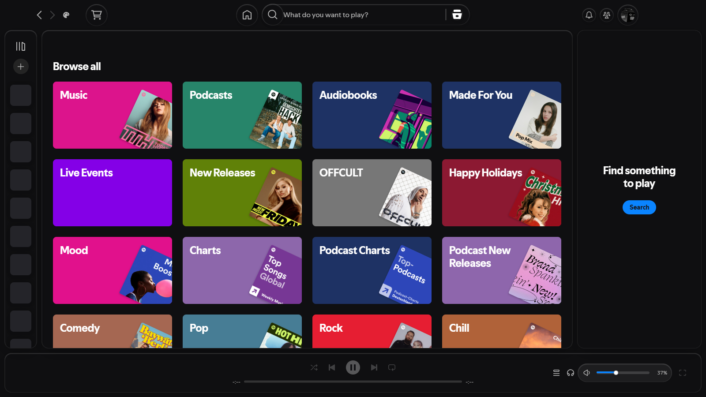
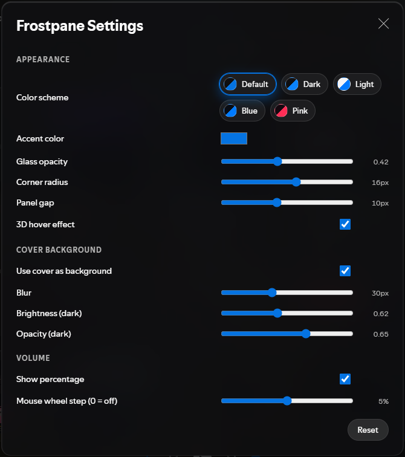

# Frostpane

Frosted-glass Spotify theme for [Spicetify](https://spicetify.app): floating glass panels over a blurred
cover of the song that is playing, soft shadows and spring animations.



## Features

- Glass panels with the current album cover as a blurred, color-boosted background
- 4 color schemes (Dark, Light, Blue, Pink) that switch **live**, no `spicetify apply` needed
- In-app settings (palette icon in the top bar, or profile menu → *Frostpane Settings*):
  accent color, glass opacity, corner radius, panel gap, 3D hover, background blur/brightness/opacity
- Better volume bar: wider, always-visible knob, percentage label, mouse-wheel control
- Themed Marketplace, context menus, Spotify settings page (toggles, dropdowns) and dialogs
- Readable text on any accent color (also white or very light accents), contrast-checked in all schemes
- Settings panel in English or German, following Spotify's language



## Install

**Marketplace:** open Marketplace → Themes → search “Frostpane” → Install.

**Manual:**

```powershell
cd "$(spicetify path userdata)\Themes"
git clone https://github.com/KryptexPvP/spicetify-frostpane Frostpane
spicetify config current_theme Frostpane color_scheme Frost-Dark inject_theme_js 1
spicetify apply
```

## Compatibility

Tested with Spotify 1.3.10 and Spicetify 2.46.7. Selectors use `data-testid` / `data-encore-id`
attributes instead of Spotify's hashed class names, so the theme survives most Spotify updates.

## Performance notes

- No `backdrop-filter` on the big panels (the background is already blurred), only on menus and dialogs
- No `will-change` on cards and list rows, so no extra GPU layers for hundreds of items
- The cover background only redraws when the album changes and is preloaded before it is swapped in
